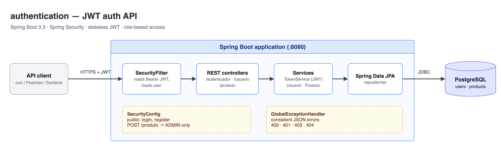

# authentication — JWT Auth API with Spring Security

A stateless REST API that registers users, issues JSON Web Tokens on login, and protects endpoints with role-based access control (`ADMIN` / `USUARIO`). Errors come back as one consistent JSON shape.



## Tech stack

- Java 17, Spring Boot 3.3
- Spring Security (stateless, custom JWT filter), [auth0 java-jwt](https://github.com/auth0/java-jwt) (HMAC256)
- Spring Data JPA, PostgreSQL (H2 for tests)
- MapStruct, Lombok, Bean Validation
- JUnit 5, Mockito, MockMvc

## How it works

1. `POST /autenticador/login` checks the credentials against the BCrypt hash in the database and returns a JWT that is valid for 1 hour.
2. On every request, `SecurityFilter` reads the `Authorization: Bearer <token>` header, validates the token and loads the user.
3. `SecurityConfig` applies the access rules. An invalid or expired token, or a user that no longer exists, gets **401**. A valid user without the required role gets **403**.

## Endpoints

| Method | Path | Auth | Description |
|---|---|---|---|
| POST | `/usuario/registrar` | public | Register a user (`role`: `ADMIN` or `USUARIO`) |
| POST | `/autenticador/login` | public | Exchange login/password for a JWT |
| POST | `/produto` | `ADMIN` | Create a product |
| GET | `/produto/{id}` | any authenticated user | Get a product by id |

### Error format

```json
{
  "timestamp": "2026-10-27T18:00:00Z",
  "status": 400,
  "error": "Bad Request",
  "message": "Validation failed",
  "path": "/produto",
  "fieldErrors": { "preco": "must not be null" }
}
```

Status codes: `400` validation / malformed body · `401` bad credentials or missing/invalid token · `403` missing role · `404` resource not found.

## Running locally

Requirements: JDK 17+ and Docker.

```bash
docker compose up -d
./mvnw spring-boot:run
```

The API starts on `http://localhost:8080`.

### Configuration

| Variable | Default | Notes |
|---|---|---|
| `JWT_SECRET` | `dev-only-insecure-secret-change-me` | **Dev only. Always set a strong secret in any real environment.** |
| `DB_URL` | `jdbc:postgresql://localhost:5432/authentication_db` | |
| `DB_USERNAME` / `DB_PASSWORD` | `admin` / `ADMIN` | Match `docker-compose.yml` |

## Example requests

```bash
# Register an admin
curl -s -X POST localhost:8080/usuario/registrar \
  -H 'Content-Type: application/json' \
  -d '{"login":"admin","senha":"admin123","role":"ADMIN"}'

# Log in and keep the token
TOKEN=$(curl -s -X POST localhost:8080/autenticador/login \
  -H 'Content-Type: application/json' \
  -d '{"login":"admin","senha":"admin123"}' | sed -E 's/.*"token":"([^"]+)".*/\1/')

# Create a product (ADMIN only)
curl -s -X POST localhost:8080/produto \
  -H "Authorization: Bearer $TOKEN" \
  -H 'Content-Type: application/json' \
  -d '{"nome":"Keyboard","preco":199.9}'

# Read it back
curl -s localhost:8080/produto/1 -H "Authorization: Bearer $TOKEN"
```

## Running the tests

```bash
./mvnw test
```

The tests use an in-memory H2 database (`test` profile), so Docker is not required. They cover token generation, validation and expiry, successful and failed login, role checks on `POST /produto`, invalid tokens, validation errors and 404s.
